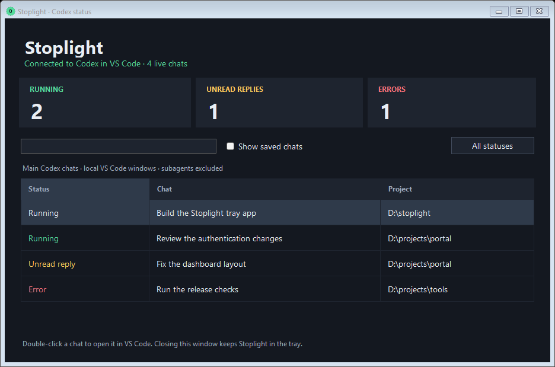

# Stoplight

A Windows tray companion for Codex in VS Code. Three numbered icons beside the clock show **running chats** (green), **unread replies** (amber), and **chats whose latest run ended in an error** (red).

Counts include main, unarchived Codex chats from local VS Code sessions. Subagents are excluded. A chat can count as both unread and failed.



## Install the Windows app

1. Install VS Code and its OpenAI Codex extension, sign in to Codex, and open the Codex panel. This version targets native Windows sessions; Windows 11 x64 is recommended.
2. Download `Stoplight-v0.1.0-win-x64.zip` from the [latest release](https://github.com/TehBandit/stoplight/releases/latest).
3. Extract the entire ZIP into a writable folder, such as a folder under your user profile. Run `Start-Stoplight.cmd` or `dist\Stoplight.exe`.
4. Open the tray overflow arrow beside the Windows clock and drag the three Stoplight icons onto the taskbar if needed.

The release includes its .NET runtime. No API key, Node, Python, administrator rights, or separate VS Code companion extension is needed. Run Stoplight as the same Windows user and at the same privilege level as VS Code.

Stoplight automatically connects to the running Codex extension and reconnects after VS Code restarts. A gray dash means the running/error count is unknown while disconnected; the unread icon retains the saved unread count.

## Use the tray icons

- Hover an icon to see its label and full count. The graphic displays `99+` for larger counts.
- Click an icon to view its matching chats. Use search or **All statuses** in the window to explore the list.
- Double-click a chat to open it in Codex. Opening a chat may mark its reply read in VS Code; monitoring alone never changes read status.
- Close the window to leave the tray app running. Right-click an icon and choose **Exit Stoplight** to quit.

For optional automatic startup, press **Win+R**, enter `shell:startup`, and place a shortcut to your extracted `dist\Stoplight.exe` in that folder. Keep the extracted app in its original location. Stoplight does not register itself for startup.

## Build and set up from source

Requirements: Windows x64, Windows PowerShell 5.1 or later, Git, and internet access for the initial SDK/package downloads.

```powershell
git clone https://github.com/TehBandit/stoplight.git
cd stoplight
powershell -ExecutionPolicy Bypass -File .\setup.ps1
.\Start-Stoplight.cmd
```

`setup.ps1` downloads Microsoft's .NET 10 SDK into `.tools\dotnet` and builds a self-contained executable in `dist`. It does not change the system SDK or PATH. Downloaded tools and packages stay inside the checkout. The execution-policy override applies only to that PowerShell process.

For subsequent builds:

```powershell
powershell -ExecutionPolicy Bypass -File .\build.ps1 -Publish
```

If you already have a .NET 10 SDK installed, you can run `build.ps1 -Publish` directly. The build prefers the project-local SDK and otherwise uses `dotnet` on PATH. Omit `-Publish` for a normal Release build.

## Validation and diagnostics

The self-test suite covers chat filtering, unread/completion/error transitions, saved errors, revision handling, malformed and fragmented pipe frames, 120 saved-chat subscriptions, and reconnection against a simulated Codex pipe. Run it with:

```powershell
$test = Start-Process -FilePath .\dist\Stoplight.exe -ArgumentList '--self-test --output artifacts\self-test.json' -Wait -PassThru
Get-Content .\artifacts\self-test.json
if ($test.ExitCode -ne 0) { throw 'Self-tests failed.' }
```

To observe your actual Codex connection for 20 seconds:

```powershell
Start-Process -FilePath .\dist\Stoplight.exe -ArgumentList '--diagnose 20 --output artifacts\live.json' -Wait
Get-Content .\artifacts\live.json
```

Diagnostics write counts and connection statistics, without prompts, replies, or tool output. Diagnostic mode is separate from the tray UI. `--preview --output artifacts\preview.png` renders the status window with sample chats.

If the icons stay disconnected, open the Codex panel in VS Code and check that both programs run under the same Windows user/privilege level. Check diagnostics for a protocol warning. If startup fails, inspect `data\startup-error.txt` beside the executable.

## Integration and limitations

Stoplight observes the Codex extension's private local named pipe. It also reads saved chat metadata and unread state using Windows' built-in SQLite library in read-only mode. Live stream updates reach the tray within roughly half a second; saved metadata and read state refresh every five seconds.

Version 0.1.0 was verified against Codex extension `26.930.61225`, stream protocol 11, and read protocol 3. This is an unofficial integration; extension updates may require an adapter update. Protocol mismatches appear as a warning instead of misleading live counts. See [integration details](docs/INTEGRATION.md).

Remote/WSL execution homes and alternative VS Code user-data directories have not been validated. Actual multiple-window behavior and full real-user unread/error transitions still need additional validation beyond the fixture tests. Previous errors in inactive chats are recovered from Stoplight's cache and available explicit terminal-error events in saved session tails; older failures without that evidence are not counted.

Runtime data is stored in `data` beside the executable. The error cache contains chat/turn IDs and timestamps; `status.json` contains connection state and counter totals. Live conversation snapshots are held in memory for incremental updates and discarded on disconnect. Stoplight does not write transcripts to logs or modify Codex settings, databases, or extension files. Runtime data, local diagnostics, downloaded SDKs, and build output are excluded from Git.
